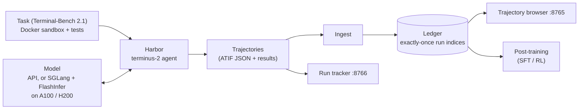

<p align="center">
  
</p>

<p align="center">
  <b>An open-source, RL-native framework for agentic LLMs — the shortest path to deployment.</b><br>
  Sandboxed tool-use environments, trajectory collection at scale, self-hosted model serving and post-training for LLM agents,<br>
  built on the same agent/environment/dataset contract, JAX + PyTorch backends and Ray rollouts that also train robot policies.
</p>

<p align="center">
  <a href="https://github.com/wzoustanford/geodesic/blob/main/LICENSE"></a>
  
  
  
  
  
</p>

<p align="center">
  <b>Applications:</b> Agentic RL (terminal & coding agents)&nbsp;·&nbsp;LLM serving&nbsp;·&nbsp;LLM post-training&nbsp;·&nbsp;Robotics&nbsp;·&nbsp;Vision-Language-Action (VLA)&nbsp;·&nbsp;RL research
</p>

---

## Why Geodesic?

Agentic LLMs — models that plan, call tools and act in a terminal or codebase over many steps — are where the big labs, the research community and enterprises are putting their effort. Training them is a reinforcement learning problem: an agent acts in an environment, a verifier scores the outcome, and the trajectories become training data. Geodesic is an RL-native framework for that loop.

Rather than being built around a training loop, Geodesic formalizes the orchestration, agent, model, environment and replay dataset components as stable abstractions. The same components that train robot policies on MetaWorld now run LLM agents in sandboxed environments, which makes it simple to build algorithms with multiple models (actor, advantage, critic, reward), speed them up with backends (JAX, torch inductor, Triton), and scale them with distributed systems (Ray, streaming data, DDP/FSDP). The agentic stack lives in [`aees/`](aees/) and covers the whole loop: environments and trajectory collection on [Harbor](https://github.com/harbor-framework/harbor), self-hosted model serving on SGLang + FlashInfer, and post-training.

- **Agentic environments with verifiable rewards.** Terminal-Bench 2.1 tasks run as Docker sandboxes through Harbor; the `terminus-2` agent drives a tmux terminal, and each task's tests produce the reward. Hosted APIs (e.g. GPT-5.6 Luna) and self-hosted open models (Qwen3 on our own GPUs) plug into the same pipeline.
- **Trajectory collection you can trust at scale.** A SQLite ledger gives every (task, model, agent, settings) scenario exactly-once run indices, records raw facts per trial, and holds each result for review; a scheduler runs batches unattended with an aggregate-cost kill switch, and ledgers from several machines merge all-or-nothing.
- **Production-grade serving of open agent models on GPUs you can rent.** Qwen3.5-27B, a capable open agent model, is served from a single A100-40GB or H200 with SGLang and FlashInfer: a prefix-aware paged KV cache, JIT-compiled attention kernels, continuous batching, tool-call and reasoning parsing, and metrics. Two scripts take a GPU machine to an OpenAI-compatible endpoint, and every setting is benchmarked for latency, throughput, concurrency, weight precision and stress before it serves agents.
- **Dual backend, one interface.** `SACAgent` (PyTorch) and `JAXSACAgent` (JAX/Flax/Optax) implement the same `Agent` abstraction. The JAX path inherits directly from the PyTorch agent and overrides only the numerical core, so the orchestrator, dataset, and environment code are shared.
- **Distributed by design.** Experience collection runs in parallel `Ray` actors that push transitions through a `Ray Queue` into a replay buffer, while training stays centralized on the learner. Data-collection throughput scales independently of training compute.
- **Robotics + foundation models in the same stack.** Classic control and offline RL live next to OpenVLA-7B fine-tuning on LIBERO, behind one orchestrator pattern.
- **Layered abstractions.** A single base class per subsystem (`Agent`, environment config, dataset) with concrete implementations that are free to vary. Public interfaces are stable; internals are swappable.
- **Reproducible & lightweight to start.** [`uv`](https://docs.astral.sh/uv/)-managed environment, deterministic CI, and a fast unit-test suite that runs without a GPU.

```python
# The whole loop, regardless of backend:
agent = JAXSACAgent(state_dim=59, action_dim=4)      # or SACAgent(...) for PyTorch
orc   = Orchestrator(agent, data_config, num_epochs=10,
                     env_config=MetaworldConfig(env_id="MT10"),
                     warmstart_steps=100)
orc.start_online()
```

---

## Highlights

| Capability | What you get |
|---|---|
| **Agentic environments** | Terminal-Bench 2.1 via Harbor (Docker sandboxes, tmux terminal agent, test-based rewards); a 20-task training set chosen for a 10–90% pass band plus a 20-task test set and 8-task validation set |
| **Trajectory data** | ~7.5k agent trajectories collected so far (GPT-5.6 Luna, Qwen3-4B, Qwen3.5-27B), stored with full model text, reasoning, tool calls, observations, tokens, cost and verifier output |
| **Model serving** | Qwen3.5-27B on one A100-40GB or H200 with SGLang + FlashInfer: AWQ 4-bit, FP8 and BF16 weights, MTP speculative decoding, benchmarked for TTFT, ITL, throughput, concurrency and stress, with cost per million tokens; Qwen3-4B on A100-40GB and A10 |
| **Collection tooling** | Exactly-once ledger, unattended scheduler with a budget kill switch, EC2 runners with mirror sync and ledger merge, a trajectory browser and a live run tracker (web UIs) |
| **Algorithms** | DQN / double-Q (binary & multinomial-discrete action spaces), SAC (continuous), multi-task SAC, OpenVLA imitation learning |
| **Backends** | PyTorch and JAX (`@jax.jit`, `optax`, `flax`, `distrax`), selectable per agent |
| **Distributed** | Ray actors for parallel rollout, a shared replay buffer with a background drain thread |
| **Environments** | MetaWorld MT10/MT25/MT50 and meta-RL (ML1/ML10/ML45); LIBERO via RLDS for VLA; Atari integration in progress |
| **Datasets** | Sequence replay with windowing/stride, offline train/val/test splits, prioritized-replay sum-tree (WIP), pluggable model- and rule-based rewards |
| **Foundation models** | OpenVLA-7B fine-tuning (LoRA + bf16) wired into the same `Agent`/`Orchestrator` contract; open agent LLMs (Qwen3-4B, Qwen3.5-27B) served for rollouts and post-training |

---

## Agentic RL



### Environments and trajectory collection — [`aees/harbor`](aees/harbor)

| Component | What it does |
|---|---|
| **Ledger** (`aees_harbor/ledger.py`) | One SQLite record per trial. A scenario = task + model + agent + tool mode + settings; each run index is used once, so re-runs continue where the last session stopped. Results are held until reviewed (pass / fail / retry) |
| **Ingest** (`aees_harbor/ingest.py`) | Loads Harbor job folders: run indices by start time, raw facts (reward, exception, tokens, cost, timings), idempotent |
| **Scheduler** (`aees_harbor/schedule.py`) | Runs planned batches back to back and ingests each. Stops on a STOP file, deadline, aggregate budget, API or disk problems; the kill switch cancels a running batch's whole process group at the cost cap |
| **EC2 runners** (`ec2/`, `aees_harbor/remote.py`, `aees_harbor/merge.py`) | One-command instance setup, per-instance plans with disjoint task shares, a 5-minute mirror sync to the laptop, and an all-or-nothing ledger merge |
| **Trajectory browser** (`aees_harbor/browse.py`, port 8765) | Ledger by task → runs → step-by-step trajectory (model text and reasoning, tool calls, observations, verifier tests); model and source drop-downs; ingest button |
| **Run tracker** (`aees_harbor/status.py`, port 8766) | Active runs across the laptop and EC2: per-task outcomes, exceptions, throughput, projected finish, API and compute cost vs. caps |

Start here: [`aees/harbor/README.md`](aees/harbor/README.md) (runbook, exact commands for API and self-hosted models) and [`aees/harbor/ec2/EC2.md`](aees/harbor/ec2/EC2.md) (scaling out).

```bash
cd aees/harbor && uv sync
uv run python -m aees_harbor.schedule --plan state/<plan>.json          # collect trajectories
uv run python -m aees_harbor.browse --ledger state/ledger.sqlite        # http://127.0.0.1:8765
uv run python -m aees_harbor.status --schedule state/<plan>.json        # http://127.0.0.1:8766
```

### Model serving — [`aees/serving`](aees/serving)

Agentic RL needs a model endpoint that many parallel rollouts can hit at once, and an open model whose weights can later be post-trained. `aees/serving` serves **Qwen3.5-27B** — a 27B dense hybrid model (48 Gated DeltaNet + 16 full-attention layers) with strong tool-calling skills — on a single, easy-to-rent GPU: an **A100-40GB** ($1.99/h on-demand) or an **H200 141GB** ($6.56/h). It is a full service, not a toy example:

- **SGLang** runs the OpenAI-compatible server: continuous batching, a prefix (radix) cache that reuses an agent's shared system prompt and tool schemas (96.6% of prompt tokens hit it on the H200), chunked prefill, CUDA graphs, a memory manager that splits the GPU between weights, KV cache and DeltaNet state, Qwen tool-call and reasoning parsers, MTP speculative decoding, and Prometheus metrics.
- **FlashInfer** provides the attention and sampling kernels: a paged KV cache, split-KV load balancing for batches of mixed lengths, and kernels JIT-compiled per variant on first use and cached on disk.
- **Two scripts, under 10 minutes:** `setup_host_qwen3_27B.sh` installs CUDA 13, SGLang 0.5.21, matching FlashInfer wheels and the weights; `serve_qwen3_27B.sh start` brings up the endpoint. The first start on a fresh A100, including JIT compilation, took 6.7 minutes; warm restarts take 65–75 s.

Every setting goes through the same benchmark matrix (`run_bench.py`, Phase 3) and FlashInfer kernel study (`run_phase4.sh`, Phase 4), each capped at 30 minutes per GPU, and the results are committed to [`aees/serving/bench_results/`](aees/serving/bench_results/):

| | A100-40GB (AWQ 4-bit) | H200 (best setting) |
|---|---|---|
| One user: time per token (ITL) | 16.0 ms; **6.4 ms with MTP** | **8.4 ms** (AWQ) |
| One user: time to first token, cached prompt | 86 ms | 66 ms |
| Agent traffic: output throughput | 228 tok/s at 32 concurrent (state cache 80) | **2,449 tok/s** at 64 concurrent (FP8) |
| Cost per 1M output tokens, agent traffic | $2.42 | **$0.74** |
| Tool-call accuracy (37 prompts, right tool + arguments) | 100% | 100% |
| Failed requests across all stress tests | 0 | 0 |

What we learned:

- **Pick the GPU by traffic.** Under load the H200 costs 3.3× more per hour but serves ~10× more agent tokens, so it is about 3× cheaper per token. For one developer or a demo, the A100 streams a usable 62 tokens/s for under a third of the hourly price.
- **Weight precision is a decode vs prefill trade-off.** AWQ 4-bit (Marlin) is fastest for one stream, since decoding is memory-bound, but drops to 0.5× BF16 speed on large prefills. FP8 runs on Hopper's FP8 tensor cores (1.76× BF16 at 4K tokens) and is the best all-rounder on the H200: highest throughput and the shortest waits on 8K-token prompts.
- **On 40 GB, a hybrid model makes serving a three-way memory budget.** Each running request holds ~150 MB of DeltaNet state, and with the prefix cache on SGLang keeps 5 state slots per request, which capped the A100 at 9 running requests while the KV cache sat mostly unused. A larger state cache (`--max-mamba-cache-size 80`) raises the cap to 16 and throughput by ~28% but shrinks the KV cache below the shared prompts' size; MTP speeds one stream 2.5× but leaves room for only 3 requests; turning off the prefix cache allows 32 requests and suits unrelated chats. Each is the right choice for a different job.
- **Keep the BF16 KV cache for this model.** With only 16 attention layers and 4 KV heads, KV reads are a small share of decode time, so FP8 KV made decode attention ~1.35× slower on the H200 and 2–12× slower on the A100 (no FP8 hardware). Paging layout and page size changed decode time by under ~10%.
- **Ship a warm JIT cache.** Most attention variants compile in 6–18 s on first use (prefill kernels up to 69 s on the H200), which is the bulk of a cold start.

The earlier **Qwen3-4B** study (A100-40GB and A10) built the same pipeline at a smaller scale and found the prefix cache to be the biggest lever for agent traffic (turning it off cut throughput 59%), with FlashInfer beating Triton attention by 17% in throughput. Start here: [`aees/serving/README.md`](aees/serving/README.md).

```bash
cd aees/serving
bash setup_host_qwen3_27B.sh                                # once per GPU host
./serve_qwen3_27B.sh start                                  # API on 127.0.0.1:30000 (WEIGHTS=fp8|bf16 on 80 GB+)
python run_bench.py --model qwen3.5-27b                     # Phase 3 benchmarks, 30-minute cap
MODEL=qwen3.5-27b ./run_phase4.sh                           # Phase 4 FlashInfer kernels, 30-minute cap
```

### Post-training — `aees/post_training` (in progress)

<!-- post-training agent: summarize GRPO (+ optional LoRA SFT) of Qwen3.6-27B on TB 2.1 here once PR #23 lands. -->
GRPO post-training of an open model on the training tasks, evaluated on the held-out test and validation sets (PR #23).

---

## Architecture at a glance

<p align="center">
  
</p>

Three subsystems, coordinated by an orchestrator:

- **`Agent`** — `select_actions()`, `update()`, `save()` / `load()`. The Q-learning family shares a double-Q base (`BaseQLAgent → DiscreteQLAgent → {BinaryActionQLAgent, MultinomialActionQLAgent}`); `SACAgent` adds an actor and learnable temperature; `JAXSACAgent` re-implements the numerical core in JAX while reusing everything else.
- **Environment** — a frozen-dataclass config (`MetaworldConfig`, …) acts as a factory that `spawn()`s vectorized gym environments and declares observation/action spaces.
- **Dataset** — `SequenceDataset` stores fixed-length windows; `OfflineRLDataCollection` builds train/val/test splits from trajectory CSVs; `ParallelReplayBuffer` drains a Ray queue into local sequence storage; everything is consumed through a PyTorch `DataLoader`.
- **`Orchestrator`** — drives the collect → store → sample → train loop, handles validation/checkpointing, and (in `ParallelReplayOrchestrator`) launches and syncs distributed workers.

For the full distributed runtime design, see [`mds/ray_jax_runtime.md`](mds/ray_jax_runtime.md).

---

## Quickstart

Install [`uv`](https://docs.astral.sh/uv/) if you don't have it:

```bash
curl -LsSf https://astral.sh/uv/install.sh | sh
```

Clone and set up the environment:

```bash
git clone https://github.com/wzoustanford/geodesic.git
cd geodesic
uv venv --python 3.12
source .venv/bin/activate
uv sync
```

> **Python 3.12 is required** — `mujoco` and `metaworld` do not yet publish wheels for newer versions.

Run the lightweight unit tests (no GPU needed):

```bash
uv run --with pytest pytest -q tests/test_*.py
```

The `test_*.py` suite covers Vaso reward logic, `SequenceDataset` windowing and batch shapes, and multinomial action discretization. The `tests/ut_*` files are longer end-to-end smoke scripts (run individually, below) and are intentionally **not** part of the default unit suite.

---

## Examples

### Online RL — SAC on MetaWorld MT10

```bash
# PyTorch backend
python -m tests.ut_online_rl_metaworld_mt10

# JAX backend (JIT-compiled SAC update)
python -m tests.ut_online_rl_metaworld_mt10_jax
```

### Parallel experience replay (Ray)

```bash
# Multiple Ray rollout workers feed a shared replay buffer; learner trains centrally
python -m tests.ut_parallel_replay_metaworld_mt10_jax
```

### Offline RL

```bash
python -m tests.ut_offline_rl
```

Works from offline trajectories (`offline_rl_random_sample_data.csv`) split into train/val/test sets, with manual or model-based rewards configured via the files in `configs/`.

### Vision-Language-Action (OpenVLA-7B)

```bash
# Fixture-based forward/backward smoke test (parses anywhere; runs e2e on GPU + HF_TOKEN)
python -m tests.ut_vla

# Real LIBERO RLDS pipeline end-to-end (GPU + HF_TOKEN + LIBERO shards)
python -m tests.ut_vla_rlds
```

OpenVLA is treated as a sibling repo on `PYTHONPATH` rather than a hard dependency (its pins conflict with Geodesic's). See [`mds/vla_v1_with_openvla_dep_remote_setup.md`](mds/vla_v1_with_openvla_dep_remote_setup.md) for the clean-machine GPU setup, and [`mds/ray_jax_runtime.md`](mds/ray_jax_runtime.md) for the runtime architecture.

<p align="center">
  
</p>

---

## Support matrix

| Algorithm | Backend(s) | Action space | Status |
|---|---|---|---|
| DQN / double-Q | PyTorch | Binary | ✅ |
| DQN / double-Q | PyTorch | Discrete / multinomial | ✅ |
| SAC | PyTorch, JAX | Continuous | ✅ |
| Multi-task SAC (MTSAC) | JAX (`vmap` over tasks) | Continuous | ✅ |
| OpenVLA (imitation) | PyTorch (LoRA + bf16) | 7-DoF EEF embodiment | ✅ |
| DQN (EfficientZero-style Atari) | JAX | Discrete | 🔭 in progress |

**Embodiments / data:** OXE, LIBERO (RLDS). **Environments:** MetaWorld MT10/MT25/MT50, meta-RL ML1/ML10/ML45.

---

## Benchmarks — JAX vs PyTorch

SAC on MetaWorld MT10 (10-task multi-task robotics), measured **CPU-only** on a MacBook Pro (see [`mds/jax_speedup.md`](mds/jax_speedup.md)):

<p align="center">
  
</p>

- **~19% lower wall-clock** end-to-end (JAX 1.3 min vs PyTorch 1.6 min over 10 epochs / 5000 steps).
- **JIT warmup is a one-time cost** — JAX's first epoch is ~3× slower (XLA tracing), then runs ~2× faster per epoch at steady state; cumulative time crosses over by epoch 5.
- The gap is **expected to widen on GPU** with larger batches, where XLA kernel fusion and vectorized env parallelism have more room to exploit hardware.

> Numbers reflect a small CPU smoke configuration and are meant to illustrate the JIT/steady-state trade-off, not to be a maximal-throughput benchmark.

---

## What makes the JAX path fast

The JAX backend compiles the full SAC update — critic, actor, temperature, and soft target update — into a single XLA program:

- `@jax.jit` on the end-to-end update and on action sampling
- `optax` optimizer chains with immutable `TrainState` / `CriticTrainState` pytrees threaded through JIT
- `distrax` for tanh-squashed Gaussian policies with exact log-prob correction inside the graph
- `jax.vmap` for per-task critic/actor losses and `jax.tree.map` for gradient averaging across tasks
- explicit `PRNGKey` management replacing PyTorch's global RNG

The PyTorch→JAX mapping is documented item-by-item in [`mds/jax_structure.md`](mds/jax_structure.md).

---

## Dataset schema

The canonical transition schema consumed by the offline pipeline and replay buffers:

| Field | Type | Dimensions | Description |
|---|---|---|---|
| `states` | `np.ndarray` | `(N, S)` | Normalized observed states for each transition |
| `actions` | `np.ndarray` | `(N, A)` | Actions taken at each transition |
| `rewards` | `np.ndarray` | `(N,)` | Scalar reward received after each transition |
| `next_states` | `np.ndarray` | `(N, S)` | Normalized successor states after each transition |
| `dones` | `np.ndarray` | `(N,)` | Episode termination flags (`True` if terminal) |
| `n_transitions` | `int` | `—` | Total number of transitions `N` across all trajectories |
| `n_trajs` | `int` | `—` | Total number of trajectories collected |
| `state_features` | `list[str]` | `(S,)` | Ordered list of feature names for state dimensions |

> **Shape key:** `N` = transitions, `S` = state dimension, `A` = action dimension.

A VLA-specific schema (images, language instructions, action chunks, dataset provenance) extends this for the RLDS path — see [`mds/ray_jax_runtime.md`](mds/ray_jax_runtime.md#data-contracts).

---

## Project layout

```
geodesic/
├── agents.py            # Agent ABC, BaseQLAgent → Discrete/Binary/Multinomial QL, SACAgent
├── jax_agents.py        # JAXSACAgent: JIT-compiled SAC, inherits the PyTorch contract
├── models.py            # PyTorch Q-networks + ModelSharedStorage (Ray param server)
├── jax_models.py        # Flax modules: actor, critic ensemble, temperature
├── datasets.py          # Sequence/Transition datasets, ParallelReplayBuffer, offline pipeline
├── orchestrator.py      # Orchestrator, ParallelReplayOrchestrator, DataWorker (Ray actor)
├── vla_agent.py         # OpenVLAAgent (LoRA + bf16 imitation learning)
├── vla_models.py        # OpenVLA-7B wrappers (vision, projector, language, policy)
├── vla_datasets.py      # RLDS transform/dataset + padded collator + synthetic fixtures
├── vla_orchestrator.py  # Supervised IL orchestrator for VLA agents
├── envs/                # MetaWorld configs (MT/ML), gym vectorized env factories
├── configs/             # Data + feature configs (offline RL, VLA/LIBERO)
├── projects/            # Domain projects (e.g. vaso clinical reward logic)
├── tests/               # test_*.py unit suite + ut_*.py e2e smoke scripts
├── mds/                 # Design docs: JAX plan, Ray+JAX runtime, OpenVLA, Atari
└── aees/                # Agentic RL
    ├── harbor/          # Environments + trajectory collection: ledger, scheduler, EC2 kit, web tools
    ├── serving/         # Self-hosted model serving (SGLang + FlashInfer), benchmarks, bench_results/
    └── post_training/   # Post-training on collected trajectories (in progress)
```

---

## Roadmap

- **Prioritized replay** — promote the sum-tree `PrioritySampler` from sketch to a tested, production prioritized-replay path.
- **Atari / EfficientZero** — DQN on Atari via a dedicated env stack and parallel replay (see [`mds/atari_env_efficient_zero_investigation.md`](mds/atari_env_efficient_zero_investigation.md)).
- **Agentic RL post-training** — GRPO on the Terminal-Bench training tasks with an open model, evaluated on the held-out test and validation sets; native tool-calling agents alongside `terminus-2`.
- **More agentic environments** — extend collection beyond Terminal-Bench (e.g. SWE-bench / SWE-bench Pro) through the same Harbor pipeline.
- **Trajectory quality** — classify harness errors from collected data, then add an LLM judge for uncategorized failures with a human-review bucket.
- **VLA post-training** — GRPO/PPO for VLA policies, replay-buffer construction, and contextual inference management.
- **Serving for RL rollouts** — serve post-trained checkpoints through the same scripts, a BF16 DeltaNet state (`--mamba-ssm-dtype bfloat16`) to raise A100 concurrency, and multi-GPU / multi-node serving for large rollout fleets.
- **Training optimizations** — RAM-efficient large-model training (PyTorch FSDP and related techniques).
- **Test coverage** — offline data prep, orchestrator metrics, checkpoint save/load, Ray replay lifecycle, MetaWorld/JAX smoke, and VLA wrappers.

---

## Contributing

We're looking for core developers. If the roadmap above resonates — agentic RL environments, LLM serving and post-training, distributed RL runtimes, JAX numerics, or VLA/robotics foundation models — we'd love to hear from you.

- **Reach out:** [will@angle.ac](mailto:will@angle.ac)
- **Pick up a workstream:** each roadmap item above is designed as an incremental, self-contained extension to the existing architecture.
- **Before a PR:** run `uv run --with pytest pytest -q tests/test_*.py` and make sure new public interfaces come with tests.

---

## Citation

If you use Geodesic in your research, please cite the repository:

```bibtex
@software{geodesic_2026,
  title  = {Geodesic: An Open-Source Framework for Agentic and Robotics Reinforcement Learning},
  author = {AngleNexus},
  year   = {2026},
  url    = {https://github.com/anglenexus/geodesic}
}
```

## License

Apache License 2.0 — see [`LICENSE`](LICENSE). © 2026 AngleNexus.

---

## Changelog

<!-- post-training agent: add PR23 when merged. -->
- **Oct 27, 2026** — Run tracker: multi-plan view, active-runs overview and cost split, outcomes in start order; scheduler waits for running Harbor jobs on Linux; Qwen run scripts ([PR24](https://github.com/anglenexus/geodesic/pull/24)).
- **Oct 24, 2026** — Practical Qwen3.5-27B serving on one A100-40GB or H200 with SGLang + FlashInfer: AWQ 4-bit / FP8 / BF16 weights, MTP speculative decoding and DeltaNet state-cache sizing; 30-minute benchmark and FlashInfer kernel runs with results committed to `bench_results/` ([PR22](https://github.com/anglenexus/geodesic/pull/22)).
- **Oct 22, 2026** — Agentic RL environments: trajectory collection on Harbor / Terminal-Bench 2.1 with an exactly-once ledger, unattended scheduler with budget kill switch, EC2 runners with ledger merge, trajectory browser and run tracker ([PR21](https://github.com/anglenexus/geodesic/pull/21)).
- **Oct 11, 2026** — Self-hosted model serving: Qwen3-4B on SGLang + FlashInfer, from a blank GPU host to a running server, a benchmark matrix (latency, throughput, QPS, p99.9 tails, burst, cold start, tool-call quality) with an HTML dashboard, and a FlashInfer deep dive on paged KV, JIT compilation and load balancing ([PR19](https://github.com/anglenexus/geodesic/pull/19)).
- **May 13, 2026** — OpenVLA-7B training/fine-tuning from LIBERO is supported ([PR12](https://github.com/wzoustanford/geodesic/pull/12)).
- **Apr 20, 2026** — Ray integration: parallel experience replay via distributed tasks ([PR11](https://github.com/wzoustanford/geodesic/pull/11)).
- **Apr 16, 2026** — JAX backend: SAC on MetaWorld ([PR9](https://github.com/wzoustanford/geodesic/pull/9)).
