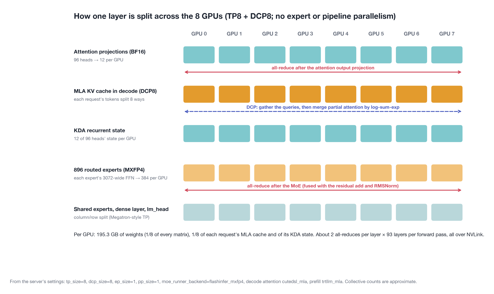
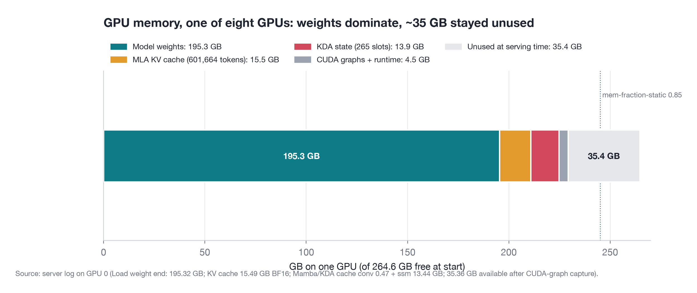
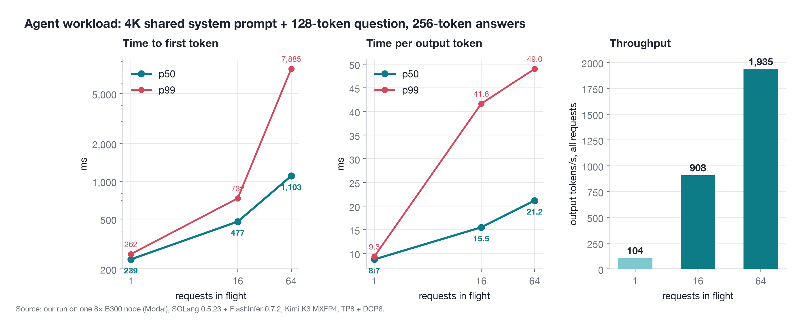
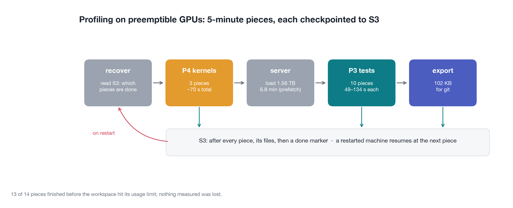

# Serving open agent models on SGLang + FlashInfer: Kimi K3, Qwen3.5-27B, Qwen3-4B

This folder takes a rented GPU machine to a running, benchmarked SGLang server with FlashInfer kernels. The same
tests run for every model:

- **Phase 3, load testing:** latency, throughput, concurrency, p99.9 tails, cold start, Poisson arrivals and a tool-call quality check.
- **Phase 4, kernel profiling:** FlashInfer microbenchmarks at the model's real attention and GEMM shapes.

| Model | Size | Hardware | Results | Write-up |
|---|---|---|---|---|
| **Kimi K3** (`moonshotai/Kimi-K3`) | 2.78T total, ~104B active, MXFP4 experts | 1 node, 8× B300 (Modal, preemptible) | `bench_results/kimi-k3_b300_kimi-20261103-145854/` | [Medium](https://medium.com/@willyouzhizou/serving-2-8-trillion-parameter-open-agent-model-kimi-k3-on-8xb300-gpus-f71b4a549fb7), [`blog_kimi_k3/`](blog_kimi_k3/index.html) |
| **Qwen3.5-27B** | 27B dense hybrid | 1× A100-40GB, 1× H200 | `bench_results/qwen3.5-27b_*` | [Medium](https://medium.com/@willyouzhizou/serving-a-capable-open-source-agent-model-on-gpus-you-can-actually-rent-qwen3-5-27b-63887455c92f), `bench_results/blog_source.md` |
| **Qwen3-4B** | 4B dense | A100-40GB, A10 | dashboards on the host | this README |

Agentic evaluations against these servers (SWE-bench Verified and others, through Harbor) live in `geodesic/aees/harbor/`.

---

## Kimi K3 on one 8× B300 node

Kimi K3 is the leading open-weights model on the Artificial Analysis Intelligence Index (57). Its model card reports
Terminal-Bench 2.1 88.3, BrowseComp 91.2 and OSWorld-Verified 84.8. We served the full checkpoint (revision
`f831ab66`, 1.56 TB in 96 shards) on a single node, profiled it, and kept the whole run under a $200 budget.
About $49 of Modal compute was actually spent.

The engineering blog ([Medium](https://medium.com/@willyouzhizou/serving-2-8-trillion-parameter-open-agent-model-kimi-k3-on-8xb300-gpus-f71b4a549fb7); source in `blog_kimi_k3/`) covers the reasoning behind every choice below, with 15 figures. The figures
can be regenerated from the committed data with `figs.py`.

### Why one node, and how the model fits

- **Precision is the checkpoint's own.**
  - The routed experts are 2.72T of the 2.78T parameters. They ship in MXFP4 from quantization-aware training (E2M1 values, one E8M0 scale per 32, 4.25 bits per weight).
  - Attention, shared experts, embeddings and norms stay in BF16 (57B parameters).
  - Re-quantizing to NVFP4 or FP8 would only add error.
- **The B300 node is the smallest single NVLink domain that holds it.**
  - 8 × 288 GB HBM3e at 8 TB/s per GPU, with NVLink 5 at 1.8 TB/s per GPU.
  - Two 8× H200 nodes would also fit, but would put the all-reduce traffic on InfiniBand.



**Memory per GPU (of 268.6 GiB usable):**

| Item | Size | Notes |
|---|---|---|
| Weights | 195.3 GB | each GPU holds 1/8 of every layer (TP8) |
| KV cache (MLA latent) | 15.5 GB | 601,664 tokens per GPU, 4.81M across the node with DCP8 |
| KDA recurrent state | 13.9 GB | 265 slots (conv 0.47 GB + SSM 13.44 GB) |
| CUDA graphs | 0.5 GB | decode batch sizes 1–53 |
| Free | 35.4 GB | left by `--mem-fraction-static 0.85` |

**The concurrency cap is set by the KDA state, not the KV cache.**
- 69 of the 93 layers are Kimi Delta Attention: linear attention with a fixed-size state per request.
- With `mamba_radix_cache_strategy extra_buffer`, each request takes 5 state slots, so 265 slots give **53 running requests**.
- Requests beyond 53 queue for a slot. The KV cache has room for about 1,000 agent requests of ~4.5K tokens.



### How it is distributed

- **TP8 (tensor parallel):** every GPU holds a slice of every layer. That includes the experts: with `ep_size 1`, each expert's matrices are split eight ways instead of being placed whole on one GPU.
- **DCP8 (decode context parallel):** the MLA layers keep a single latent KV head. Rather than copying it to all 8 GPUs, DCP splits the cached tokens 8 ways and merges the partial attention results.
- **No expert parallelism, no pipeline parallelism, no FSDP.**
  - Expert parallelism (EP) would add all-to-all traffic.
  - Pipeline parallelism (PP) would add pipeline bubbles.
  - FSDP is a training technique: it re-gathers the weights on every step, which inference never needs.
- **Communication:**
  - About 186 all-reduces per forward pass: 760 KB each in decode, up to 235 MB each in a 16K-token prefill chunk.
  - SGLang uses its custom all-reduce with NVLink multicast (48 MB of symmetric memory per GPU), plus a K3-specific fusion of the all-reduce with the residual add and RMSNorm. NCCL 2.30.7 is the fallback.
  - In decode the messages are small, so the cost is round trips: about 186 × 5 µs ≈ 0.9 ms per token. In prefill it is bandwidth (an estimated 0.46 ms per 235 MB all-reduce).
  - FlashInfer's `allreduce_fusion` offers the same fusion as a library call; `--enable-flashinfer-allreduce-fusion` was off in this run.

### Serving setup

```
sglang 0.5.23 (lmsysorg/sglang:v0.5.23-cu130)
--tp 8 --dcp 8 --moe-runner-backend flashinfer_mxfp4
--prefill-attention-backend trtllm_mla --decode-attention-backend cutedsl_mla --page-size 64
--chunked-prefill-size 16384 --mem-fraction-static 0.85
--weight-loader-prefetch-checkpoints --weight-loader-prefetch-num-threads 1
```

- **Startup took 17 min.**
  - Weights: 6.8 min.
  - FlashInfer MoE autotune (`trtllm_fp4_block_scale_moe`): 3 min 47 s.
  - Decode CUDA graphs: 74 s.
- **Without the prefetch flags,** each of the 8 ranks read all 12.5 TB of shard data, and loading took about 60 min.
- **Thinking mode** is off per request with `chat_template_kwargs: {"thinking": false}`. Pass `smoke_test.py --no-think` to send it.

### Phase 3: load testing

| Test | Output tok/s | TTFT p50 / p99 | ITL p50 |
|---|---|---|---|
| Agent ×1 | 104 | 239 / 262 ms | 8.7 ms |
| Agent ×16 | 908 | 477 ms | 15.5 ms |
| Agent ×64 | 1,935 | 1,103 / 7,885 ms | 21.2 ms |
| p999 run ×64 (400 requests) | 2,062 | 684 / 7,207 ms | — |
| Chat ×64 | 1,483 | 2,662 ms | — |
| Long context ×16 | 441 | 5,307 ms | — |
| Cold start ×16 | 663 | 1,991 ms | — |
| Poisson 4 req/s | 875 | 565 ms | ITL p99 248 ms |

- **The TTFT tail at 64 users is the 53-request cap.**
  - About 17% of requests waited about 7 s for their first token, which matches the 11 of 64 requests above the cap.
  - The server sat at 53 running requests, with up to 38 queued.
- **A single stream decodes at 8.7 ms per token,** against a 2.15 ms floor (17.2 GB read per GPU per token at 8 TB/s).
  - All-reduces explain about 1 ms.
  - The rest is the KDA recurrence, MoE routing, the DCP merge, sampling and gaps between kernels (an estimate, not a profile).
- **Prefix cache hit rate was 0.949** on agent traffic.
- **36 of 37 tool calls were correct.** The miss was "Convert 42 USD to INR."
- **Cost:** $7.65–8.15 per 1M output tokens at 64 users, at $56.80/h for the 8 GPUs. The Kimi API lists $15. A single user costs $152 per 1M.



### Phase 4: kernel profiling (`fi_bench_kimi.py`, timed with CUDA graphs)

- **MLA decode:**
  - DCP8 is 1.5–5.7× faster than TP8.
  - An FP8 KV cache halves TP8 decode time (40.6 → 18.6 µs per layer at 16 requests × 8K), because TP8 is bandwidth-bound. Under DCP8 the gain is smaller (12.9 → 11.5 µs), because each GPU already reads 8× less.
  - Page layout (contiguous vs scattered) costs under 3%.
- **Expert GEMMs:**
  - MXFP4 runs at 3.0× BF16 at 4,096 tokens (5.3 PFLOPS).
  - It is compared with FP8, MXFP8 and NVFP4 at the same shapes.
- **First-use costs** (JIT compilation and autotuning) are recorded separately from steady-state timings.

### Piecewise checkpointing on preemptible GPUs

Modal GPU functions are always preemptible, and on-demand 8× B300 capacity was unavailable at Nebius and Vast.ai for
hours (`capacity_watch.py`). So the run is cut into pieces of 5 minutes or less, and each one is saved to S3 as soon as it finishes:

| # | Piece | Stage | What |
|---|---|---|---|
| 1–3 | `p4_mla`, `p4_fp4`, `p4_report` | Phase 4 | MLA decode; GEMM formats; report |
| 4–13 | `p3_agent_c1/c16/c64`, `p3_chat_c64`, `p3_long_c16`, `p3_quality`, `p3_cold16`, `p3_rate4`, `p3_p999`, `p3_burst` | Phase 3 | one load point each, against a shared server (`run_bench.py --reuse-server --points`) |
| 14 | `export` | export | `export_results.py` → `bench_results/` format |

- **S3 layout:** `s3://<bucket>/serving/kimi-k3/runs/<run-id>/`
  - `files/` mirrors the results folder.
  - `done/<piece>.json` is written only after a piece's files are uploaded.
  - `attempts/<piece>-<time>-rc<code>.json` records every try.
  - `status/current.json` holds the current piece and stage, which the live page reads.
- **`recover_and_check_status(run_id)`** runs first on every (re)start:
  - It restores the finished files from S3, then lists the pieces still pending.
  - A piece that fails twice is skipped. Exit code 99 (server not ready yet) is not counted as a failure.
- **Guard rails:**
  - `guard.json` on the results Volume holds a 2-hour deadline and stops after 3 restarts.
  - No piece starts if it could run past the deadline.
  - The GPU function's timeout is a hard stop.
  - `touch /tmp/STOP` or `modal app stop` ends the run early.
- **Credentials:** AWS credentials reach the container through the Modal secret `kimi-k3-aws`. They are never written to a Volume.
- **Offline testing:** `SIMULATE=1` exercises the bookkeeping (done markers, retries, skip rules, restore) without a GPU.
- **Outcome:** run `kimi-20261103-145854` survived its restarts and finished 13 of 14 pieces. Only `p3_burst` was lost, when the workspace hit its spend limit; the export was finished on the laptop from S3.



### How to run

```bash
# Laptop, from geodesic/aees/serving/ (Modal CLI: uv tool install modal && modal setup)
modal secret create kimi-k3-aws AWS_ACCESS_KEY_ID=... AWS_SECRET_ACCESS_KEY=... AWS_DEFAULT_REGION=...
modal run modal_kimi_k3.py::download                 # once: 1.56 TB into the kimi-k3-weights Volume (CPU only)
modal run modal_kimi_k3.py::preflight                # shards, tokenizer, bench_serving flags (CPU)
modal run modal_kimi_k3.py::s3_selftest              # S3 write/read from inside Modal
modal run modal_kimi_k3.py::dev                      # ~3 min on 1x B300: image + Phase 4 kernels
modal run --detach modal_kimi_k3.py::run             # 8x B300; --run-id <id> continues an earlier run

python progress_dashboard.py --run-id <run-id>       # live page: current piece/stage, data cached on S3
python pieces_kimi_k3.py status --run-id <run-id>    # same, as text
python smoke_test.py --no-think                      # through the SSH tunnel printed by the run (port 30000)

modal run modal_kimi_k3.py::fetch                    # exported results -> bench_results/
modal run modal_kimi_k3.py::teardown --confirm       # back up to S3, verify, delete both Volumes
```

On a plain 8× B300 VM, use these instead of Modal:
- `nebius_kimi_k3.sh up|status|tunnel|sync|resume|fetch|down`
- `setup_host_kimi_k3.sh` (installs Docker and the NVIDIA toolkit, sets a kill-switch deadline)
- `serve_kimi_k3.sh` and `run_kimi_k3.sh`

`kimi_k3_plan.md` has the cost model, the kill switches and a log of every attempt (preemption, loader fix, capacity hunt).

### Kimi K3 files

| File | Purpose | Runs on |
|---|---|---|
| `modal_kimi_k3.py` | Modal app: `download`, `preflight`, `s3_selftest`, `dev`, `run` (8× B300, sshd + tunnel, guard), `sync`, `fetch`, `teardown` | Laptop → Modal |
| `pieces_kimi_k3.py` | The 14 pieces, S3 checkpoints, `recover_and_check_status`, per-piece time limit, `SIMULATE` mode | GPU container (status also from the laptop) |
| `serve_kimi_k3.sh` | SGLang server in tmux with the flags above; `TP`, `DCP`, `MEM_FRACTION`, `CONTEXT_LEN`, `MAX_RUNNING`, `LOAD_FLAGS` env vars | GPU host |
| `run_kimi_k3.sh` | Steps `kernels`, `serve`, `phase3`, `export`, `hold` for a non-Modal host; reuses earlier results | GPU host |
| `fi_bench_kimi.py` | Phase 4: `mla` (TP8 vs DCP8, BF16 vs FP8 KV, paging), `fp4` (BF16/FP8/MXFP8/MXFP4/NVFP4 GEMMs), `report`; `--quick` | GPU host |
| `setup_host_kimi_k3.sh`, `nebius_kimi_k3.sh` | Nebius 8× B300 VM path: host setup with a kill-switch deadline; VM lifecycle and S3 sync | GPU host / laptop |
| `capacity_watch.py`, `capacity_dashboard.py` | Every 15 min, checks for on-demand 8× B300 capacity at Nebius (3 regions), Vast.ai, Prime Intellect and Shadeform; renders an HTML page | Laptop |
| `progress_dashboard.py` | Live run page from S3 and Modal state, rebuilt every 30 s | Laptop |
| `blog_kimi_k3/` | Engineering blog (`index.html`), 15 figures in `img/`, `figs.py` and its data in `data/` | — |

Additions to shared scripts for Kimi K3:
- `run_bench.py`:
  - a `kimi-k3` profile, Blackwell GPU detection, and FP8 e4m3 KV on Blackwell;
  - `low_latency` (DCP off) and `kda_bf16` arms;
  - `--reuse-server` and `--points` to run single points against a live server.
- `export_results.py`: exports the Phase 4 `mla` and `fp4` results.
- `smoke_test.py`: `--no-think`.

### Kimi K3 limitations and follow-ups

- **`p3_burst` (256 simultaneous requests) was not measured.** Rerun it with `--run-id kimi-20261103-145854` to resume.
- **Raising the 53-request cap is the next lever.** Three settings would raise it; none was measured:
  - a higher `--mem-fraction-static` (35 GB per GPU sat idle);
  - `--mamba-radix-cache-strategy extra_buffer_lazy` (4 slots per request instead of 5);
  - `--mamba-ssm-dtype bfloat16` (half the bytes per slot).
  - If the cap rises above 64, the 7 s TTFT tail at 64 users should disappear.
- **Untested settings:** FP8 KV in the live server (not just the kernel test), FlashInfer all-reduce fusion, and the `low_latency` arm.
- **Single-run numbers:** each point was measured once. The ITL tail explanation (chunked prefill interleaving) is a hypothesis, not a measurement.

---

## Qwen3-4B and Qwen3.5-27B

Nine scripts take a blank Ubuntu 22.04 GPU host (the one OS for every host) to a running Qwen3 server, benchmark it,
and investigate FlashInfer's key mechanisms. The venv, logs and results live in `~/qwen-serve`, outside the repo.

- **Phases 1–2, serving:** one script installs the driver, CUDA 13, SGLang and version-matched FlashInfer wheels; another runs the server with FlashInfer attention, the prefix cache and Prometheus metrics.
- **Phase 3, benchmarks:** an unattended matrix covering latency, throughput, QPS, p99.9 tails, burst and cold start, across five server settings, plus a tool-call quality check. The output is one interactive HTML dashboard.
- **Phase 4, FlashInfer deep dive:** microbenchmarks and a live capture for block-sparse KV memory, JIT compilation of attention variants, and split-KV load balancing. The output is one HTML report with explanatory diagrams above the measured charts.

### Files

| File | Purpose | Runs on |
|---|---|---|
| `setup_host.sh` | Phases 1–2: driver (R580+), CUDA 13.0 toolkit, uv venv, SGLang (pinned 0.5.21), FlashInfer wheels pinned to the installed `flashinfer-python`, model download, FlashInfer correctness check. Idempotent | GPU host |
| `serve.sh` | Server lifecycle in tmux: `start`, `stop`, `restart`, `status`, `logs`, plus `dashboard` (serves results on :8000) and `tunnel` (prints the laptop SSH command). Settings via env vars (`EXTRA_ARGS`, `SERVER_ENV`, `PORT`, `DASH_PORT`, …) | GPU host |
| `smoke_test.py` | Validation over the tunnel: plain chat, a tool call, a prefix-cache hit, then an optional interactive stdin/stdout chat with streaming, TTFT and a demo tool loop | Laptop |
| `run_bench.py` | Phase 3 matrix: restarts the server per setting, runs `sglang.bench_serving` sweeps, samples `/metrics` every second, runs the tool-call quality check. Supports `--quick`, `--dry-run`, `--resume`, `--arms` | GPU host |
| `make_dashboard.py` | Phase 3 dashboard from per-request data: KPI cards, settings-vs-baseline table, capacity curves, percentiles to p99.9, QPS sweep, cold vs warm, KV usage over time, quality table, GPU telemetry | GPU host |
| `run_phase4.sh` | Phase 4 in one command: `kernels`, `jit`, `trace`, `report` (or `all`). Keeps going past a failed stage and logs a problem summary | GPU host |
| `fi_bench.py` | Phase 4 microbenchmarks (`sparse`, `balance`, `jit`) and the report builder (`report`), at Qwen3-4B attention shapes | GPU host |
| `fi_jit_setup.sh` | Builds a "cold" venv (same torch and FlashInfer, no prebuilt kernels, private JIT cache) so compilation can be measured | GPU host |
| `fi_trace.py` | Opt-in server hook that saves FlashInfer's paged-KV index arrays every 50th `plan()` call. Loaded only by `run_phase4.sh trace`; inert unless `FI_TRACE_DIR` is set | GPU host (server process) |
| `setup_host_qwen3_27B.sh` | Qwen3.5-27B: runs `setup_host.sh`, downloads the AWQ 4-bit, FP8 and BF16 checkpoints (AWQ only on GPUs under 75 GB), checks each fits the GPU | GPU host |
| `serve_qwen3_27B.sh` | Qwen3.5-27B server lifecycle, like `serve.sh`; `WEIGHTS=awq\|fp8\|bf16` picks the checkpoint, thinking on with the `qwen3` reasoning parser | GPU host |
| `export_results.py` | Shrinks a Phase 3 run and a Phase 4 folder into `bench_results/<run-id>/` (~100 KB): readable `summary.md` and run log, per-point percentiles, tails, quality, time series, kernel results | GPU host |
| `bench_results/` | Committed results, one folder per run; its README explains every file and column | Repo |

### How to run

```bash
# GPU host, from geodesic/aees/serving/
bash setup_host.sh            # once per host; reboot and rerun if it installs a driver
./serve.sh start              # API on 127.0.0.1:30000
./serve.sh dashboard          # results on 127.0.0.1:8000
./serve.sh tunnel             # prints the laptop tunnel command

# Laptop
ssh -N -L 30000:127.0.0.1:30000 -L 8000:127.0.0.1:8000 ubuntu@<gpu-host-ip>
python smoke_test.py          # tests, then an optional interactive chat

# GPU host, inside tmux
python run_bench.py --quick   # ~15 min pipeline check; full run without --quick (~1.5 h)
./run_phase4.sh               # ~45-60 min
```

Dashboard: `http://127.0.0.1:8000/<run-id>/dashboard.html`. Phase 4 report: `http://127.0.0.1:8000/fi/fi_report.html`.

### Qwen3.5-27B on A100-40GB and H200

`run_bench.py --model qwen3.5-27b` and `MODEL=qwen3.5-27b ./run_phase4.sh` run Phases 3 and 4 for the 27B, each capped
at 30 minutes (`--budget-min` / `BUDGET_MIN`). Points that don't fit are skipped and logged in `run_log.md`.

- **A100-40GB:** AWQ 4-bit (the only checkpoint that leaves room for the KV cache on 40 GB), compared with prefix cache off and MTP speculative decoding.
- **H100/H200:** the three weight precisions, AWQ 4-bit (W4A16, Marlin), FP8 (W8A8, 128×128 blocks) and BF16, on the same tests.
- **Phase 4:** runs at the 27B's attention shapes: 24 query heads, 4 KV heads, head_dim 256. Only its 16 full-attention layers use FlashInfer; the other 48 are Gated DeltaNet. It adds FP8 e4m3 KV and a weight-precision GEMM test (2d) that uses SGLang's own FP8-block and Marlin kernels.
- **Results:** export to `bench_results/` and are committed from the GPU host.

### Findings: Qwen3-4B

#### Phase 3 (A100-40GB, quick run, agent workload at 64 concurrent requests)

| Setting | Output tok/s | TTFT p99 | ITL p99 |
|---|---|---|---|
| Prefix cache off (`--disable-radix-cache`) | −59% | +424% (≈20 s) | +18% |
| FP8 KV cache (`--kv-cache-dtype fp8_e5m2`) | −5% | +2% | +17% |
| KV page size 16 | −1% | +1% | −1% |
| Triton attention instead of FlashInfer | −17% | +21% | +27% |

- **The prefix cache is the biggest lever** for agent traffic with shared system prompts and tool schemas.
- **FlashInfer beats Triton** by 17% throughput and 21–27% tail latency.
- **FP8 KV is a capacity tool, not a speed tool, on Ampere.** It roughly doubles KV pool capacity, but costs speed because the A100 has no FP8 math.
- **Page size makes no measurable difference.** FlashInfer reads scattered single-token pages efficiently.
- **TTFT, not streaming speed, limits concurrency.** ITL p99 stayed within the 50 ms SLO at every level tested.

#### Phase 4 (A10)

- **JIT compilation:** each new attention variant costs about 7–15 s to compile on first use and about 1 ms afterwards. `prefill_causal` reused the module that `decode_tensorcores` had just built, since tensor-core decode runs on the prefill kernel. Production hosts avoid the compile cost by installing the prebuilt `flashinfer-cubin` and `flashinfer-jit-cache` wheels.
- **Block-sparse KV and load balancing:** see `fi_report.html` for scattered-vs-contiguous bandwidth, FP8 vs BF16 kernel time, split-KV speedups on skewed batches, `plan()` cost per layer, and the live KV index map captured from the running server.

### Design notes

- **Measurement hygiene (all models):**
  - The prefix cache is flushed before every point.
  - Agent points are warmed with the same prompts before measuring, and a separate "cold" point keeps the empty-cache burst.
  - All percentiles are computed from per-request data.
  - Each setting differs from the baseline by exactly one flag.
- **Ports:** API on 30000, dashboard on 8000, both bound to 127.0.0.1 and reached through one SSH tunnel. Lambda's firewall only opens port 22.
- **Version pinning:** the FlashInfer kernel wheels must match `flashinfer-python` exactly, including the `-smXX` provider packages, or FlashInfer refuses to import. Kimi K3 sidesteps this by using the pinned SGLang Docker image.
- **Robustness:**
  - Scripts call each other via `bash`, so a lost execute bit doesn't break them.
  - `run_phase4.sh` puts the venv's `bin` and CUDA on `PATH`, since FlashInfer's JIT shells out to `ninja` and `nvcc`.
  - Python output is unbuffered so progress is visible.
- **Trace hook isolation:** `fi_trace.py` is linked as `sitecustomize.py` in a scratch folder outside the repo, so only the traced server process loads it.

### Testing

- Phases 1–4 run end to end on Lambda A100-40GB (Phases 1–3) and A10 (Phase 4) hosts. The Qwen3.5-27B runs are on A100-40GB and H200.
- Shell scripts pass `bash -n` and `shellcheck -S warning`; Python files pass `pyflakes`.
- Dashboard and report rendering checked in headless Chromium against synthetic results, with no page errors.
- `smoke_test.py`'s streaming tool-call loop and interactive prompt tested on a pseudo-terminal against a mock OpenAI-compatible server.
- `fi_trace.py` capture tested through the symlinked `sitecustomize.py` path.

### Known limitations and follow-ups

- Qwen3-4B Phase 3 findings come from one `--quick` run. Rerun the full matrix before quoting numbers externally, and treat differences under about 5% as noise.
- Phase 4 absolute numbers are from an A10 (about 600 GB/s, 72 SMs). The patterns should carry over to the A100, but its kernels run roughly 2.5× faster.
- The proposed SLO (TTFT p99 ≤ 500 ms, ITL p99 ≤ 50 ms) still needs product sign-off. Rebuild the dashboard with different SLOs via `make_dashboard.py --slo-*`, without rerunning anything.
- Warm agent points repeat identical prompts, so even the question tokens are cached, which makes warm TTFT slightly optimistic (by a few ms).

## Reviewer checklist

- [ ] `results/` and `logs/` are not committed (they live in `~/qwen-serve`, on the Modal results Volume, or on S3). Only the compact exports in `bench_results/` are committed, and `.nebius/` (VM state, raw logs) is gitignored
- [ ] Shell scripts are executable in git: `git update-index --chmod=+x geodesic/aees/serving/*.sh`
- [ ] No hostnames, IPs or keys in the scripts (the tunnel command uses `<gpu-host-ip>`; AWS credentials come from a Modal secret)
